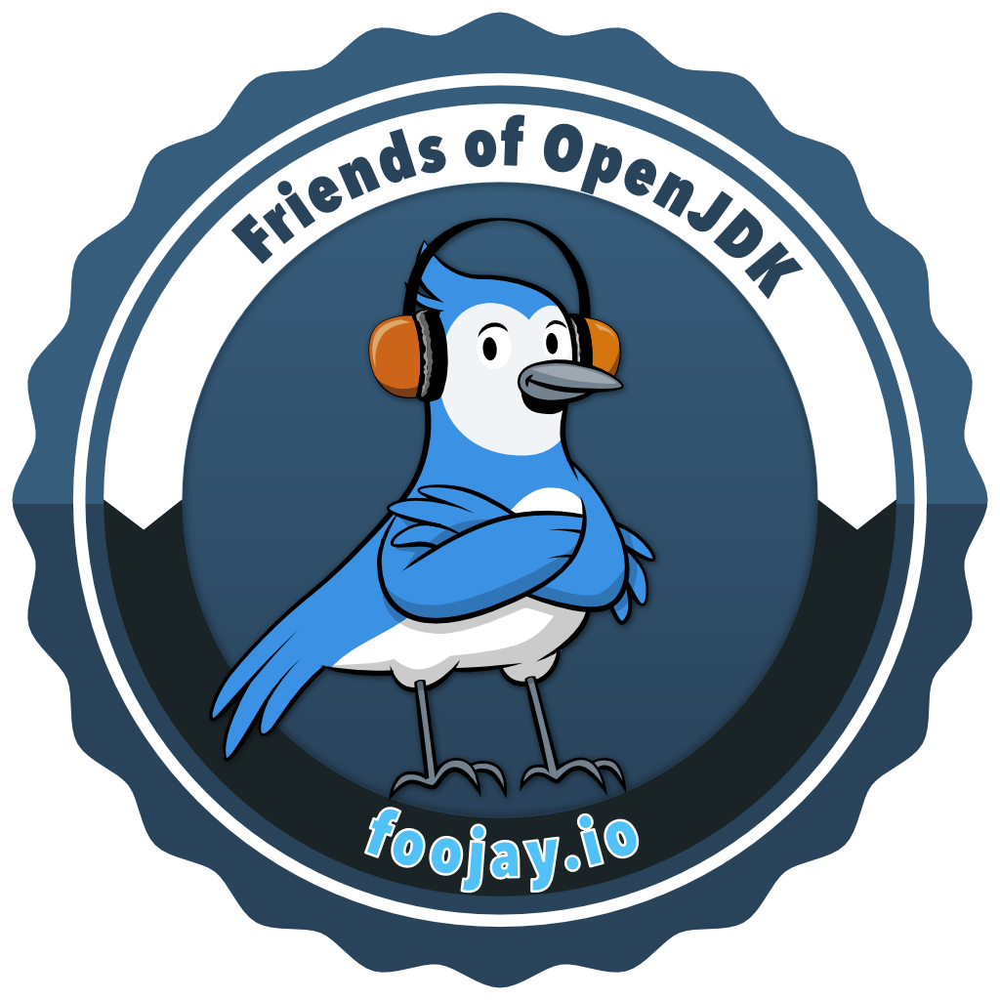
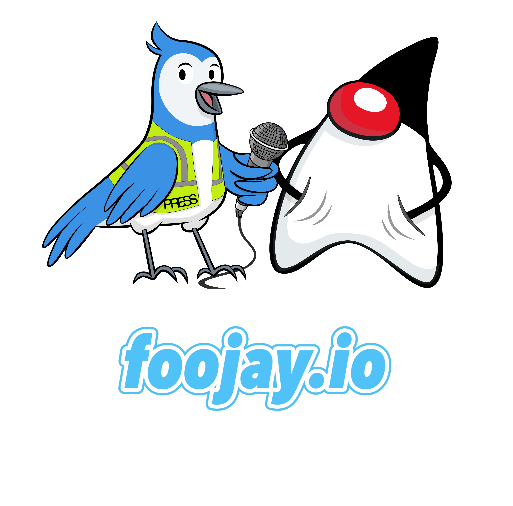
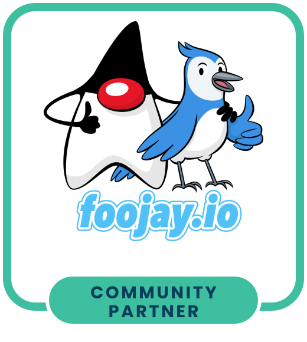

# Foojay Logo

Different versions of the logo, originally created by [Gerrit Grunwald](https://github.com/HanSolo). For more info, see the [Foojay website](https://foojay.io/who-we-are/).

## Name Logo

## Foojay and Duke

## Podcast

### Stamp

### Reporter

## Sponsor Badges

Badges for Foojay sponsors and community partners to display on their own site, one per tier.

### Bronze

### Silver

### Gold

### Community Partner

